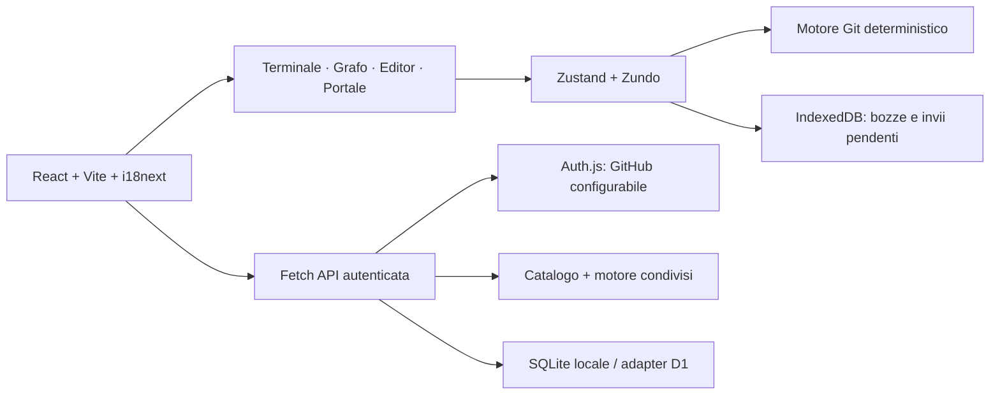

# Architettura del laboratorio Git

Implementazione locale approvata il 15 novembre 2026. Il prodotto è pubblico,
indipendente e aperto a tutti. La pubblicazione e la configurazione degli account
rimangono separate dal lavoro locale. Decisione: [ADR 0002](adr/0002-public-git-lab.md).

## Componenti implementati

| Percorso | Responsabilità |
| --- | --- |
| `apps/web` | navigazione, IT/EN, temi, finestre, sessione in memoria, persistenza e invii |
| `packages/contracts` | azioni, scenari e risposte API versionati |
| `packages/course-content` | 36 moduli, spiegazioni, guide OS/SSH, obiettivi e soluzioni IT/EN |
| `packages/git-engine` | working tree, index, commit, refs, conflitti e replay puro |
| `services/progress-api` | autenticazione, autorizzazione, tentativi, risultati e classifica |

Il browser non esegue subprocessi, installazioni o rete simulata. Terminale Bash,
GitHub e Azure DevOps sono sottoinsiemi didattici dichiarati; `help` elenca i comandi.
Le guide per il computer distinguono Windows, Linux e macOS 26+. I file e i comandi
SSH del laboratorio usano esclusivamente identità fittizie.

Zundo conserva soltanto la repository simulata. Il log di azioni registra anche
undo, redo e reset; il server ne ricostruisce gli effetti. Sessione e progressi
confermati restano fuori dalla cronologia. L'editor salva una modifica nel modello
quando lascia il campo: questo raggruppa la digitazione in un'azione annullabile.

Il grafo disegna collegamenti fra parent effettivi e offre la stessa informazione
come elenco testuale. Le quattro finestre supportano spostamento, ridimensionamento,
minimizzazione, ingrandimento, dock e panoramica, con alternative da tastiera.
Il layout è una preferenza locale separata per account e fascia di viewport.
Un lease locale segnala l'apertura dello stesso esercizio in un'altra scheda.

## Progressi e API

| Metodo e percorso | Risultato |
| --- | --- |
| `GET /v1/config` | versione e provider effettivamente disponibili |
| `GET /v1/me` | identità della sessione |
| `PATCH /v1/me` | alias e adesione esplicita alla classifica |
| `GET /v1/me/progress` | completamenti, risultati e tier sbloccati |
| `POST /v1/attempts/start` | tentativo e orario del server |
| `POST /v1/attempts/:id/complete` | replay, verifica obiettivi e salvataggio transazionale |
| `GET /v1/leaderboard?tier=…&courseVersion=…` | primi 100 risultati pubblici per versione e livello |
| `/auth/*` | sviluppo locale, OAuth, handoff, scambio e logout |

Il server controlla proprietà del tentativo, versione, prerequisiti e limiti del
payload. Ignora punteggio e durata dichiarati dal browser. La POST finale contiene
azioni e una chiave di idempotenza: una ripetizione identica recupera lo stesso
risultato; la stessa chiave con dati differenti viene rifiutata.

Ogni prima conclusione valida vale 100 punti. Un tier vale 1.200 punti e si conclude
quando tutti i suoi 12 moduli sono verificati. Il tier seguente viene sbloccato dal
server. La durata è la somma dei tempi delle prime riuscite, dall'avvio registrato
alla ricezione valida. Ripetizioni, undo e reset non riscrivono questi risultati.
La classifica è didattica: replay valido non prova assenza di aiuti o automazione.

La bozza e la richiesta pendente vengono conservate in IndexedDB, per identità,
versione e lezione. La richiesta mantiene la stessa chiave nei retry. Il frontend
ritenta errori transitori con backoff limitato, rispetta `Retry-After`, offre un
retry manuale e riprova al ritorno online. I progressi non sono indicati come
sincronizzati prima della risposta server. Il timer ufficiale include il ritardo.

`document.visibilitychange`, `window.focus/blur`, `pagehide/pageshow` e un orologio
monotono alimentano stime private. Copertura incompleta e sospensioni lunghe sono
segnalate; il server conserva aggregati, scartando il ledger grezzo. Questi dati non
cambiano punteggio o durata ufficiale e non diventano una prova antifrode.

## Identità e archiviazione

Auth.js gestisce il flusso GitHub con state e PKCE. L'handoff fra domini usa un
codice applicativo monouso, vincolato alla challenge e allo stato della SPA. Il
bearer opaco scade dopo 30 minuti, rimane in memoria e viene conservato nel database
come hash. Il token GitHub non viene restituito al frontend. I refresh richiedono
un nuovo accesso; identità stabile e progressi vengono recuperati dal server.

GitHub compare soltanto con client ID, secret e segreto Auth.js configurati. Il
provider di sviluppo è esplicitamente fittizio e disabilitato nell'entrypoint Worker
e con `NODE_ENV=production`. Non esistono password o registrazioni locali.
Gli altri provider sono fasi future subordinate al costo zero; Apple è disabilitato.
Il flusso GitHub reale non è stato verificato con credenziali in questa sessione.

Schema in `database.ts`, adapter Node SQLite con WAL e transazioni, adapter D1 con
batch atomici. I vincoli unici proteggono tentativi attivi, invii, prime riuscite e
completamenti dei tier. Il Worker richiede schema già applicato: non effettua
migrazioni durante le richieste. Non è stata creata alcuna risorsa pubblica.

## Limiti e condizioni di rilascio

Il motore supporta al massimo 500 azioni, 160 file, 512 commit e file da 32 KiB;
l'API impone ulteriori limiti ai campi e un corpo di 256.000 byte. Merge testuali
complessi possono essere segnalati come conflitti. Il rebase supporta linee senza
merge; il revert con conflitti successivi richiede uno scenario diverso e viene
rifiutato esplicitamente. Le worktree sono snapshot rappresentati dal modello,
non filesystem completi; hook e clone usano fixture controllate.

Il limiter API è per istanza e non sostituisce un controllo globale del provider.
Budget CPU, quote gratuite, CORS e OAuth fra i domini distribuiti, ripristino D1,
retention e cancellazione dei dati personali sono gate prima della pubblicazione.
I test SQLite non certificano il runtime Worker. Fonti, quote e criteri in
[deployment.md](deployment.md); evidenze in [testing.md](testing.md).
