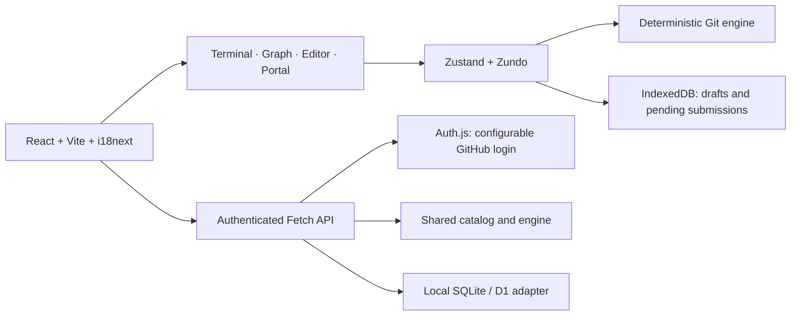

# Git lab architecture

Local implementation was approved on November 15, 2026. The product is public,
independent, and open to everyone. Publishing and account configuration remain
separate from local development. Decision: [ADR 0002](adr/0002-public-git-lab.md).

## Implemented components

| Path | Responsibility |
| --- | --- |
| `apps/web` | Navigation, IT/EN, themes, windows, in-memory session, persistence, and submissions |
| `packages/contracts` | Versioned actions, scenarios, and API responses |
| `packages/course-content` | 36 modules, explanations, OS/SSH guides, objectives, and IT/EN solutions |
| `packages/git-engine` | Working tree, index, commits, refs, conflicts, and pure replay |
| `services/progress-api` | Authentication, authorization, attempts, results, and leaderboard |

The browser does not run subprocesses, installations, or simulated network operations.
The Bash terminal, GitHub, and Azure DevOps implement explicitly documented teaching
subsets; `help` lists the commands. Computer setup guides distinguish Windows, Linux,
and macOS 26+. SSH files and commands in the lab use fictional identities only.

Zundo retains only the simulated repository. The action log also records undo,
redo, and reset; the server reconstructs their effects. Sessions and confirmed
progress remain outside history. The editor writes a change to the model when
the field loses focus, grouping typing into one undoable action.

The graph draws edges between actual parents and provides the same information
as a text list. The four windows support moving, resizing, minimizing, maximizing,
a dock, and an overview, with keyboard alternatives. Layout is a local preference
stored separately by account and viewport class. A local lease indicates when
the same exercise is open in another tab.

## Progress and API

| Method and path | Result |
| --- | --- |
| `GET /v1/config` | Version and providers actually available |
| `GET /v1/me` | Session identity |
| `PATCH /v1/me` | Alias and explicit leaderboard opt-in |
| `GET /v1/me/progress` | Completions, results, and unlocked tiers |
| `POST /v1/attempts/start` | Attempt and server start time |
| `POST /v1/attempts/:id/complete` | Replay, objective checks, and transactional save |
| `GET /v1/leaderboard?tier=…&courseVersion=…` | First 100 public results by version and tier |
| `/auth/*` | Local development, OAuth, handoff, exchange, and logout |

The server checks attempt ownership, version, prerequisites, and payload limits.
It ignores scores and durations claimed by the browser. The final POST contains
actions and an idempotency key: an identical retry retrieves the same result;
reusing the key with different data is rejected.

Each first valid completion earns 100 points. A tier earns 1,200 points and is
complete when all 12 modules are verified. The server unlocks the next tier.
Tier duration is the sum of the times for the first successful attempts, from
the recorded start to valid receipt. Repetition, undo, and reset do not overwrite
these results. The leaderboard is educational: valid replay does not prove
that a learner worked without assistance or automation.

Drafts and pending requests are retained in IndexedDB by identity, version,
and lesson. A request keeps the same key across retries. The frontend retries
transient errors with bounded backoff, respects `Retry-After`, offers manual
retry, and retries when connectivity returns. Progress is not shown as synced
until the server responds. Official elapsed time includes the delay.

`document.visibilitychange`, `window.focus/blur`, `pagehide/pageshow`, and a
monotonic clock produce private estimates. Incomplete coverage and long suspensions
are reported; the server retains aggregates and discards the raw ledger. These
observations do not change scores or official elapsed time and do not constitute
evidence against cheating.

## Identity and storage

Auth.js handles the GitHub flow with state and PKCE. The handoff between domains
uses a single-use application code bound to the SPA's challenge and state. The
opaque bearer token expires after 30 minutes, stays in memory, and is stored as
a hash in the database. The GitHub token is never returned to the frontend.
Page refreshes require another sign-in; the server recovers the stable identity
and its progress.

GitHub appears only when its client ID, client secret, and Auth.js secret are
configured. The development provider is explicitly simulated and is disabled
in the Worker entrypoint and with `NODE_ENV=production`. There are no passwords
or local registrations. Other providers are future phases subject to the zero-cost
constraint; Apple is disabled. Real GitHub login was not verified with credentials
in this session.

The schema is in `database.ts`. The Node SQLite adapter uses WAL and transactions;
the D1 adapter uses atomic batches. Unique constraints protect active attempts,
submissions, first successful results, and tier completions. The Worker requires
the schema to be applied in advance and does not migrate during requests.
No public resource has been created.

## Limits and release conditions

The engine supports at most 500 actions, 160 files, 512 commits, and 32 KiB per
file. The API adds field limits and a 256,000-byte request-body limit. Complex
text merges may be reported as conflicts. Rebase supports histories without merge
commits; a revert that introduces further conflicts requires a different scenario
and is explicitly rejected. Worktrees are snapshots represented by the model,
not complete filesystems; hooks and clone use controlled fixtures.

The API limiter is per instance and does not replace provider-level global
controls. CPU budget, free quotas, CORS and OAuth across deployed domains, D1
recovery, retention, and personal-data deletion are gates before publishing.
SQLite tests do not certify the Worker runtime. Sources, quotas, and criteria
are in [deployment.md](deployment.md); evidence is in [testing.md](testing.md).

## Sequential courses and onboarding

The learner-facing curriculum uses courses, while existing `Tier` values remain
internal storage identifiers for compatibility. The catalog contains practical
objectives only. Concepts appear before the lab; navigation exposes completed
lessons and the next eligible exercise. Server start and completion endpoints
check the full preceding-lesson prefix, including legacy pending attempts.

Guest practice uses a separate versioned local-storage progress record with zero
verified score. Confirmed account progress is loaded independently after login.
Neither completion record participates in Zundo history. The tutorial uses a
native labelled dialog with keyboard dismissal and target highlighting, without
a new runtime dependency. Theme preference is stored separately from its resolved
light/dark appearance; System subscribes to OS colour-scheme changes.
